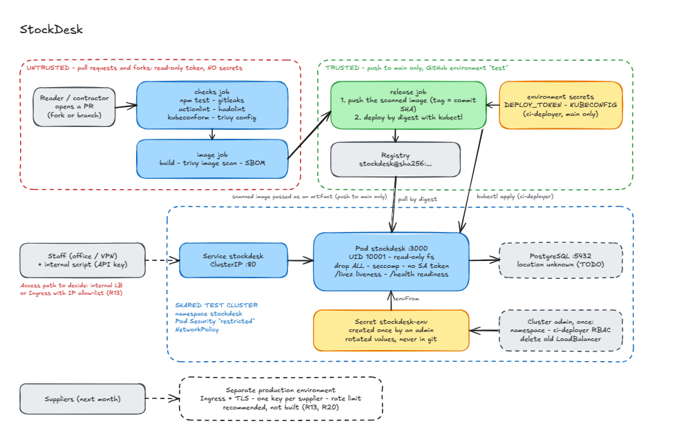

# Design note - StockDesk delivery chain

**How I understood the need.** StockDesk opens to external suppliers next
month. The CTO wants the delivery chain (repo, CI, image, cluster manifests)
safe enough for that, and a clear answer about the secrets already in the
repository. I treated it as a risk review first: fix what is exploitable
today, make each fix verifiable, and say plainly what only admins can do.
Assumptions (RISKS.md): the committed values are live and compromised, the
contractor's KUBECONFIG is cluster-admin, the LoadBalancer is public, and
suppliers will not use the shared test cluster.

**Architecture.** Untrusted code (PRs, forks) runs tests, scanners and an image
build with a read-only token and no secrets. Only `main` reaches the `test`
environment, which holds the secrets, pushes the exact image that was scanned
and deploys it by digest with `kubectl`, as a deployer limited to one
namespace. The pod runs non-root, read-only, without capabilities or API
token, behind a `ClusterIP` Service, in a namespace that enforces Pod Security
`restricted`.

Two choices I hesitated over:
1. *Who creates the Kubernetes Secret.* CI could create it from GitHub
   environment secrets (fully automated), but then CI needs write access to
   Secrets and GitHub becomes the secret store. I chose an admin-created Secret
   and a CI identity with **no** access to Secrets: less automation, smaller
   blast radius if CI is compromised. Sealed Secrets is the next step.
2. *Base image.* Distroless is smaller and has no shell; Alpine keeps a shell
   for debugging and is easier to explain. I chose `node:22-alpine`, removed
   npm/yarn (the app has no dependency) and run it as UID 10001. Same Node
   major as CI, which is what I could actually test (Node 22).

**What I tested, and what I could not.** Tested: `npm test` (10/10; the new
log test fails on the old code), a real process (probes, SIGTERM, clean log),
the deploy step's image guard (it found a gap in my first version),
`.dockerignore` with Docker's own matcher, and every CI check locally
(actionlint, hadolint, kubeconform, trivy config, gitleaks; README table).
Not tested: `docker build`, the image scan, a real workflow run, anything on a
cluster.

**What I cut, and why.** Not done, by priority: rotating the secrets (needs
admins: plan in RISKS.md); image digests (registry unreachable, marked TODO);
supplier exposure (Ingress, TLS, per-supplier keys, rate limiting) - a
recommendation, because how suppliers connect is not decided; image signing
and admission checks (cosign, Kyverno); Sealed Secrets; git history rewrite
(useless before rotation, low value after); exact NetworkPolicy rule for the
DB (location unknown); branch protection / CODEOWNERS (GitHub settings,
plan-dependent); pinning `kubectl`; monitoring and alerting.

**AI use.**

**With one more day.** Run the pipeline for real (a fork on GitHub plus a
`kind` cluster) and fix what breaks; pin the image digests; build the supplier
entry point (Ingress + TLS + per-supplier keys + rate limit) in a separate
namespace; sign images with cosign and verify them at admission; install
Sealed Secrets; move the stock to PostgreSQL so the app can run with 2 replicas
and a PodDisruptionBudget.

