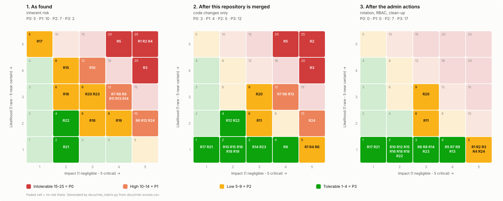

# Risk prioritisation strategy

How the 24 risks in [RISKS.md](../RISKS.md) were ranked, so that anyone can
re-score them and get the same order, and challenge a score rather than a
feeling. The method follows the usual risk-matrix approach described in two
guides that share the same title, *The Ultimate Guide to Risk
Prioritization* ([Hyperproof](https://hyperproof.io/resource/the-ultimate-guide-to-risk-prioritization/),
[MetricStream](https://www.metricstream.com/learn/risk-prioritization.html)),
adapted to a delivery chain.

## 1. The process, step by step

| Step (from the guides) | What I did for StockDesk |
|---|---|
| 1. Identify the risks | Read every file, hidden ones included; ran actionlint, hadolint, trivy and gitleaks on the original (they found about a third of the issues; see `docs/evidence/before.md`). |
| 2. Record them in a register | [RISKS.md](../RISKS.md): one ID per risk, used in the commit messages. |
| 3. Rate the likelihood | 1-5 scale, defined in section 2 by **who** can do it and **how hard** it is. |
| 4. Rate the impact | 1-5 scale, defined in section 2 by **what the attacker gets**. |
| 5. Choose the strategy | **Severity first** (score = likelihood x impact), then the tie-breakers of section 4. Not "cheapest first": a cheap fix can leave the biggest risk open. |
| 6. Prioritise, with a chart | Score -> level -> priority (section 3), matrix above, tables below. |
| 7. Decide the response | Each level has a response and a deadline (section 3). Owner per risk in RISKS.md. |
| 8. Monitor and re-score | Residual scores after the merge and after the admin actions (tables), and triggers for a re-score (section 6). |

## 2. Scoring guide

Shared definitions, so that one person's "high" is the next person's "high".
**Likelihood** = how likely it is that someone exploits it in the next months,
given *who* can reach it and *what it takes*.

| L | Meaning | StockDesk example |
|---|---|---|
| 5 | Near certain: already happened, or anyone among the 40 readers (or the Internet) can do it today with no special skill | Secrets readable in the repository (R2); a fork PR (R1) |
| 4 | Likely: easy, but depends on one unverified condition | Inspector reachable *if* the LoadBalancer is public (R3) |
| 3 | Possible: needs a specific access (write access, registry pull, log access) | Pushing a branch that deploys (R7) |
| 2 | Unlikely: needs a prior foothold or an upstream compromise | Escaping a pod with no securityContext (R12) |
| 1 | Rare: needs several conditions together, or is hard over a network | Timing attack on the key check (R21) |

**Impact** = the worst realistic outcome for Corvane if it happens.

| I | Meaning | StockDesk example |
|---|---|---|
| 5 | Critical: code execution or control in the cluster, registry or repository; all credentials | Attacker code deployed to the cluster (R1) |
| 4 | Severe: a production credential, or write access to stock data | API key or DB password exposed (R9) |
| 3 | Significant: a control silently fails, or other teams on the shared cluster are affected | Rotation undone by the next deploy (R10) |
| 2 | Limited: avoidable downtime or degraded quality, no data exposure | Restart loop when the DB is slow (R16) |
| 1 | Negligible: inconvenience | 30 s shutdown delay (R17) |

## 3. From score to priority and response

Score = L x I (1-25). The four levels are the guides' levels; the thresholds
encode Corvane's risk appetite before opening to suppliers.

| Score | Level | Priority | Response | Deadline |
|---|---|---|---|---|
| 15-25 | **Intolerable** | P0 | Not accepted. Fix or contain now; block the supplier opening until it is below 15. | Today / this change |
| 10-14 | **High** | P1 | Fix before external suppliers connect. | Before go-live |
| 5-9 | **Low** | P2 | Planned work with an owner; may be accepted temporarily with a written reason. | This quarter |
| 1-4 | **Tolerable** | P3 | Accept and monitor; fix when cheap or when touching the file. | Opportunistic |

## 4. Tie-breakers (order within a level)

Applied in this order, only between risks of the same level:

1. **Interconnectedness - fix prerequisites first.** A fix that makes other fixes
   work goes first. R1 (pipeline) before R2 (rotation): rotating while the
   pipeline leaks would leak the new secrets. R8, R9 and R10 before rotation:
   otherwise the new values end up in images, logs, or are overwritten.
2. **Higher score first.**
3. **Velocity - already happening first.** R2 is not a possibility, it is an
   exposure in progress.
4. **Impact over likelihood.** At equal score, the risk with the worse outcome
   goes first (it is also the one where the likelihood estimate is the least
   reliable).
5. **Manageability.** At equal everything, the one we can fix ourselves, in the
   repository, goes first; admin-only actions are scheduled in parallel.

Grouping: risks that are the same attack path (R1 + R4 + R5) or the same
control (R6 + R7 + R14; R8 + R9 + R10) are ranked and fixed together.

## 5. The scores

<!-- generated:start -->
| ID | Risk | L | I | Score | Level | Why this likelihood | Why this impact |
|---|---|---|---|---|---|---|---|
| R1 | PR code runs with secrets and write token | 5 | 5 | **25** | Intolerable (P0) | Any of 40 readers incl. contractor; one PR; no review | Registry + repo write + attacker code deployed |
| R2 | Production secrets committed (repo + history) | 5 | 5 | **25** | Intolerable (P0) | Already exposed to 40 readers and forks | DB + API write + registry push |
| R4 | Shell injection via PR title | 5 | 5 | **25** | Intolerable (P0) | Any reader; a PR title | Same as R1 |
| R3 | Node inspector 9229 on a LoadBalancer | 4 | 5 | **20** | Intolerable (P0) | No credentials needed; public exposure assumed (A3) | Code execution in the pod + its secrets |
| R5 | DEPLOY_TOKEN echoed in CI logs | 5 | 4 | **20** | Intolerable (P0) | Any reader can open run logs | Registry push (image poisoning) |
| R7 | Any branch push deploys | 3 | 4 | **12** | High (P1) | Needs write access (insiders) | Unreviewed code + secrets readable from a branch |
| R8 | .env and .git baked into the image | 3 | 4 | **12** | High (P1) | Needs registry pull or node access | Same secrets as R2 in a wider place |
| R9 | Secrets printed in the startup log | 3 | 4 | **12** | High (P1) | Needs kubectl logs or log-platform access | DB password + API key |
| R11 | node:latest full image running as root | 3 | 4 | **12** | High (P1) | Mutable tag; full images routinely carry known CVEs | Root in the container amplifies any RCE |
| R13 | Public plain-HTTP LoadBalancer | 3 | 4 | **12** | High (P1) | Exposure unverified; sniffing needs a network position | API key in clear = write access |
| R14 | Mutable :latest image + IfNotPresent | 3 | 4 | **12** | High (P1) | Needs a registry token (leaked: see R2) | Overwritten image deployed; no rollback |
| R10 | Deploy restores the leaked Secret | 4 | 3 | **12** | High (P1) | Automatic on the next deploy after rotation | Rotation silently undone |
| R6 | Third-party action at @main gets KUBECONFIG | 2 | 5 | **10** | High (P1) | Needs a compromise of corvane-labs (ownership unknown) | Cluster credentials of unknown scope |
| R12 | Pod without securityContext in default | 2 | 5 | **10** | High (P1) | Needs a foothold first (e.g. R3) | Escape or lateral move on a shared cluster |
| R24 | Write access can still change the workflow | 2 | 5 | **10** | High (P1) | Needs write access and a merge | Full pipeline control |
| R20 | Unauthenticated reads; one shared API key | 3 | 3 | **9** | Low (P2) | Certain once suppliers connect | Stock visible to all; no per-supplier revocation |
| R23 | Scanners blind to Corvane token formats | 3 | 3 | **9** | Low (P2) | Next leak with the same format | Undetected credential leak |
| R19 | Compose: prod password and open ports | 2 | 4 | **8** | Low (P2) | Only if compose runs on a test server (comment says so) | DB reachable with the prod password |
| R15 | Tests ignored; no security gate | 4 | 2 | **8** | Low (P2) | Broken or vulnerable code will pass sooner or later | Quality and known-CVE exposure |
| R18 | No resource requests or limits | 2 | 3 | **6** | Low (P2) | Needs a leak or abuse | Noisy neighbour on a shared cluster |
| R16 | Liveness probe depends on the database | 3 | 2 | **6** | Low (P2) | Any DB slowness or outage | Restart loop; avoidable downtime |
| R17 | SIGTERM ignored (Node as PID 1) | 5 | 1 | **5** | Low (P2) | Every rollout | 30 s hang then SIGKILL |
| R22 | No NetworkPolicy; single replica | 2 | 2 | **4** | Tolerable (P3) | Needs a foothold; enforcement unknown | Lateral movement; short outages |
| R21 | Timing-unsafe key check; unbounded body | 1 | 2 | **2** | Tolerable (P3) | Hard over a network; needs a key | Key guessing; memory use |

**Residual risk** (same scale, re-scored after each set of actions):

| ID | As found | After merge | After admin actions | What is left, and who |
|---|---|---|---|---|
| R1 | 25 P0 | 5 P2 | 5 P2 | — |
| R2 | 25 P0 | 25 P0 | 5 P2 | Admins: rotate (plan, steps 3-6) |
| R3 | 20 P0 | 20 P0 | 5 P2 | Cluster admin: delete old Service in default |
| R4 | 25 P0 | 5 P2 | 5 P2 | — |
| R5 | 20 P0 | 20 P0 | 4 P3 | Repo admin: delete old logs; rotate token |
| R6 | 10 P1 | 5 P2 | 3 P3 | Cluster admin: scoped ci-deployer |
| R7 | 12 P1 | 12 P1 | 4 P3 | GitHub admin: environment secrets on main |
| R8 | 12 P1 | 12 P1 | 3 P3 | Registry admin: delete old images |
| R9 | 12 P1 | 4 P3 | 4 P3 | — |
| R10 | 12 P1 | 2 P3 | 2 P3 | — |
| R11 | 12 P1 | 6 P2 | 6 P2 | Code: pin digest (TODO verify) |
| R12 | 10 P1 | 4 P3 | 2 P3 | Cluster admin: namespace with Pod Security |
| R13 | 12 P1 | 12 P1 | 4 P3 | Cluster admin: delete old Service; CTO: supplier entry |
| R14 | 12 P1 | 3 P3 | 3 P3 | — |
| R15 | 8 P2 | 2 P3 | 2 P3 | — |
| R16 | 6 P2 | 2 P3 | 2 P3 | — |
| R17 | 5 P2 | 1 P3 | 1 P3 | — |
| R18 | 6 P2 | 2 P3 | 2 P3 | — |
| R19 | 8 P2 | 2 P3 | 2 P3 | — |
| R20 | 9 P2 | 9 P2 | 9 P2 | CTO: product decision (per-supplier keys) |
| R21 | 2 P3 | 1 P3 | 1 P3 | — |
| R22 | 4 P3 | 4 P3 | 2 P3 | Cluster admin: confirm CNI enforcement |
| R23 | 9 P2 | 3 P3 | 3 P3 | — |
| R24 | 10 P1 | 10 P1 | 5 P2 | GitHub admin: branch protection + CODEOWNERS |
<!-- generated:end -->

## 6. Re-score when

- an assumption changes (answers to the case-study questions, the GitHub plan,
  what the KUBECONFIG really allows, whether the LoadBalancer was public);
- an admin action is done (each rotation step, RBAC, deleting the old Service);
- before suppliers connect (target: nothing above **Low**; today R20 stays at
  9 until the product decision on per-supplier keys);
- a new finding, or a scanner rule that starts failing.

## 7. What applying the method changed

Writing the scales down and scoring every risk corrected two of my first,
intuitive calls in RISKS.md:

- **R24** (anyone with write access can still change the workflow) was P2; it
  scores 2 x 5 = 10, so it is **P1**.
- In the top five, "secrets leaking at run time" (R8-R10, scores 12, and a
  prerequisite for rotation) now comes **before** "trust in the deploy chain"
  (R6 + R7 + R14, scores 10-12).

`docs/risk_matrix.py` fails if a priority in RISKS.md ever disagrees with its
score again.

## 8. Limits of this method

- **It is qualitative.** The scores are expert judgement on ordinal scales; L x I
  is a ranking device, not a measurement (a 20 is not "twice" a 10). The
  scales and examples above make the judgement explicit and challengeable.
- **No money.** A quantitative method such as FAIR would express risk as
  expected loss, but needs loss and frequency data that Corvane does not have.
- **Point in time.** Scores depend on today's assumptions (RISKS.md, A1-A6);
  section 6 lists when to redo them.
- **Residual scores assume the actions are done as written.** They do not
  replace checking (RISKS.md, rotation plan, step 7).

Regenerate the matrix and tables after editing `docs/risk-scores.csv`:
`python3 docs/risk_matrix.py`.
